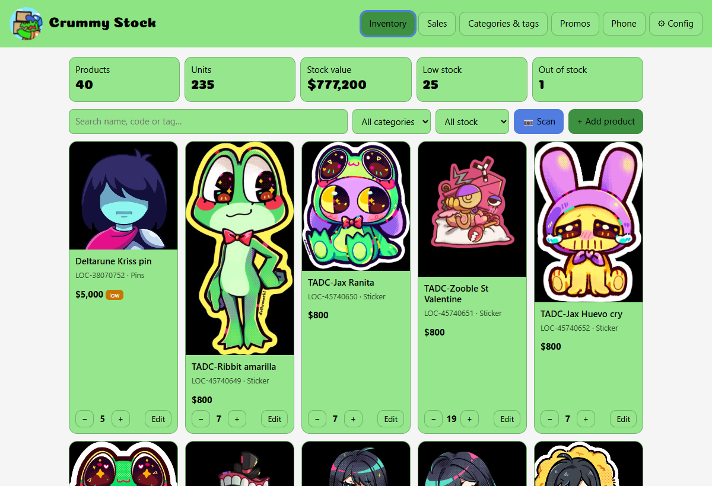
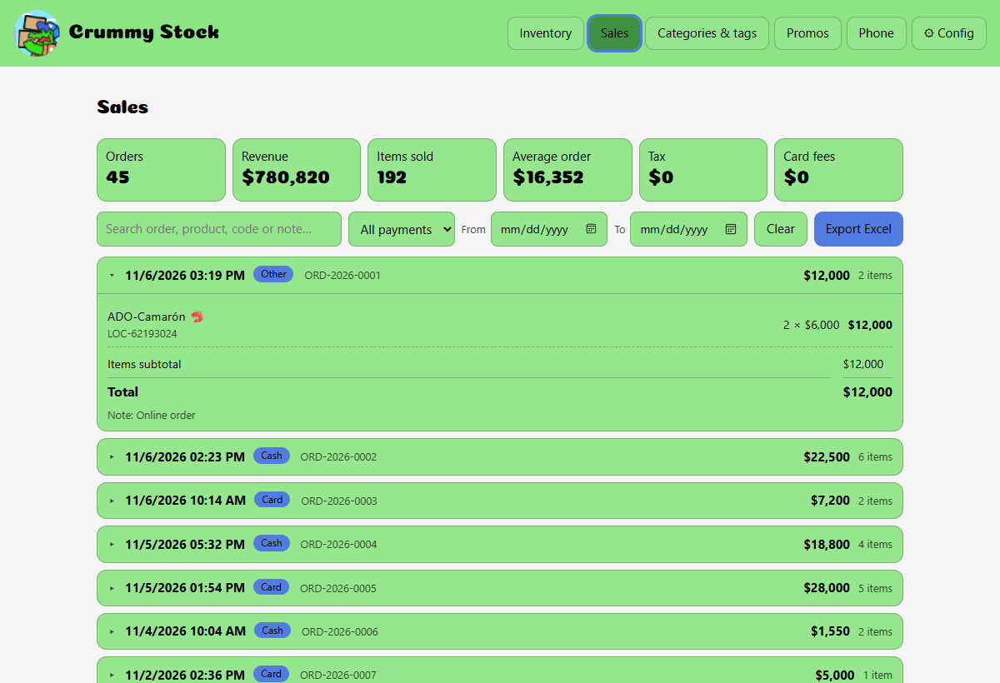
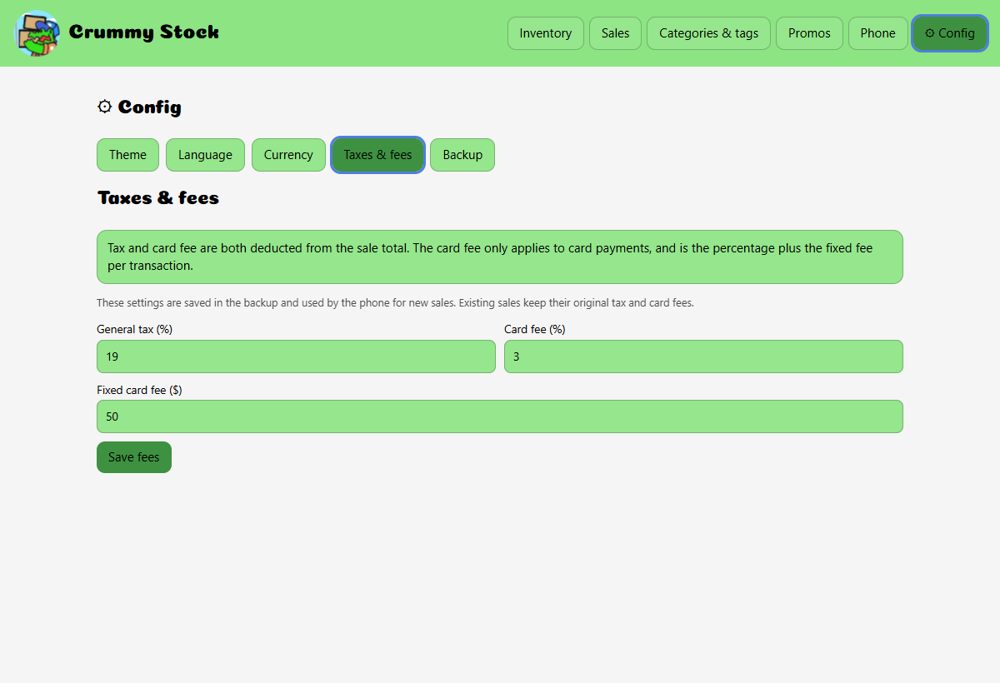
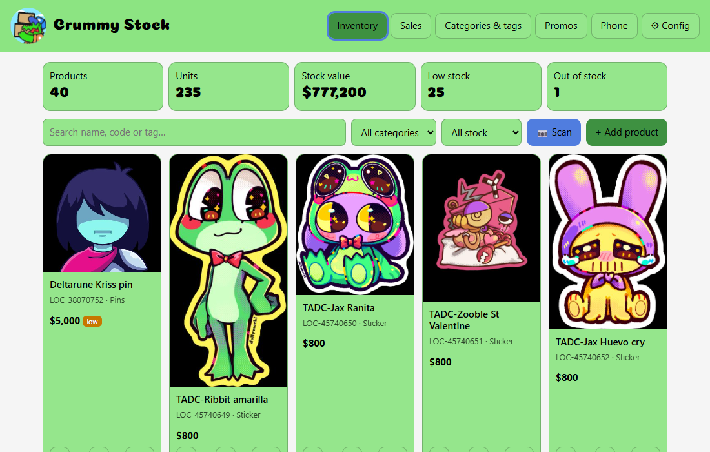
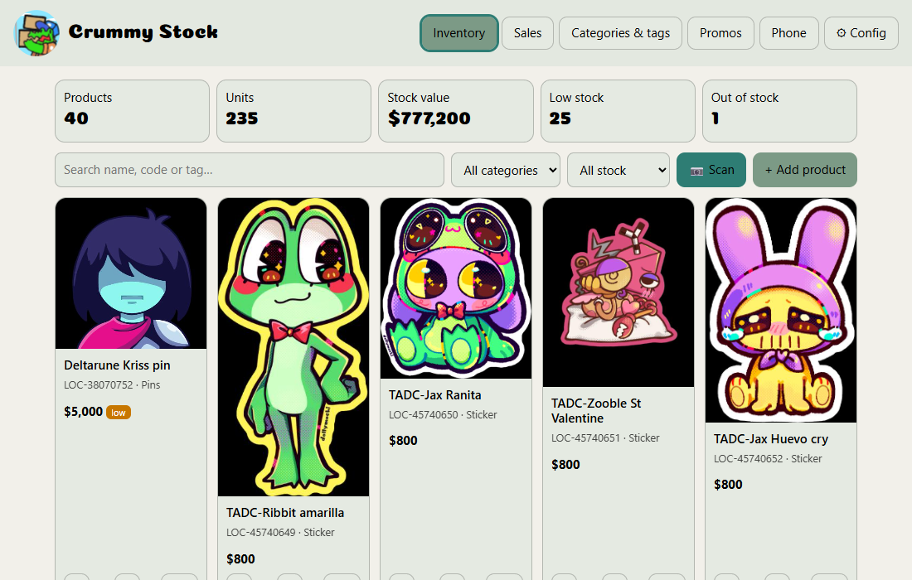
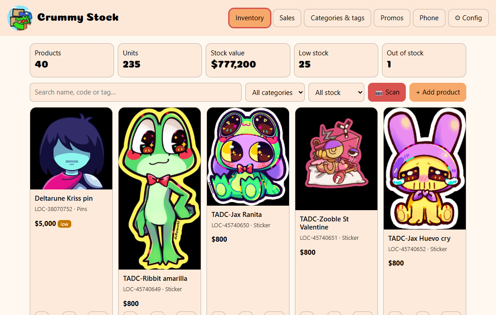
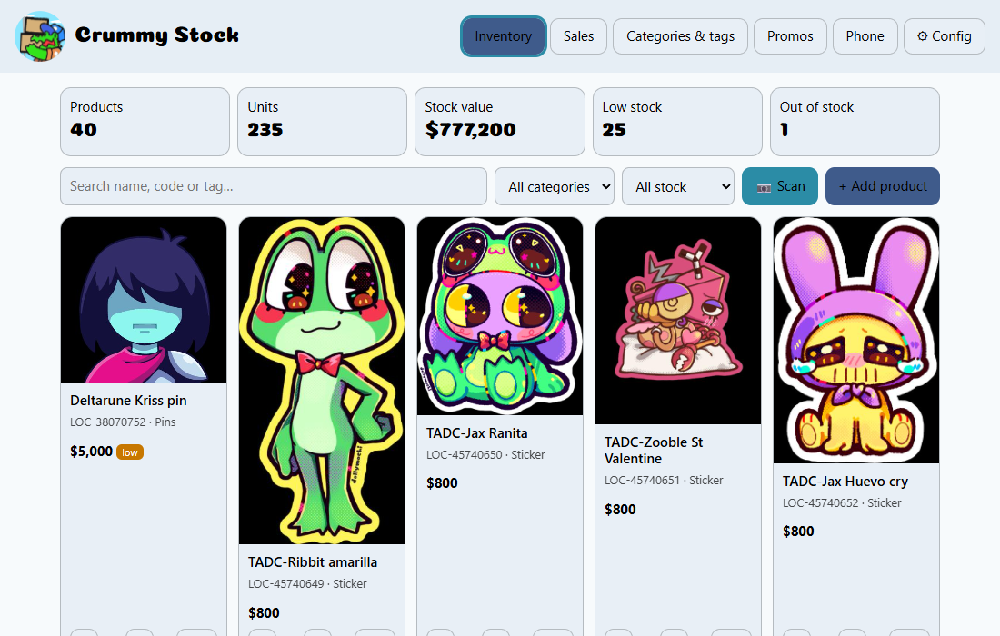
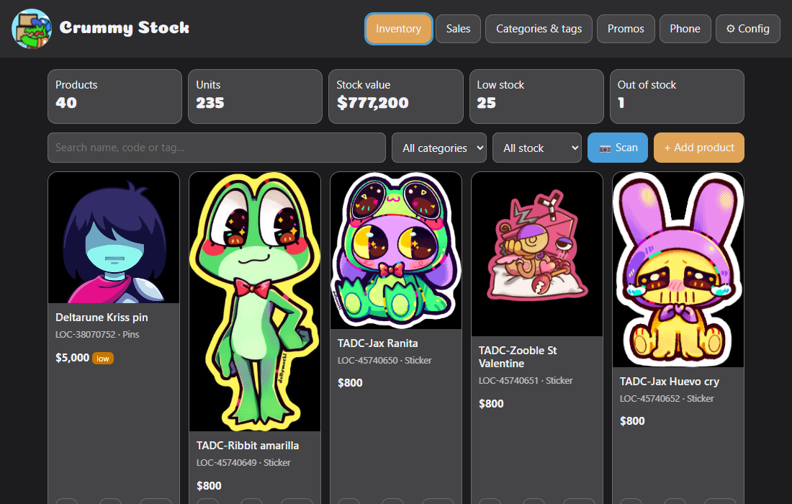

**Support me on Ko-fi:** 

**Follow me on Socials:**  

**Try it live:** [krisoll.github.io/Crummy-Stock-Web](https://krisoll.github.io/Crummy-Stock-Web/)

**Join the community:** 

# Crummy Stock — Desktop

A standalone, offline browser app for managing a small shop's inventory, promos, and
sales history. It is the desktop companion to the **Crummy Stock** Android app and can
exchange backups with it over Wi-Fi.

The whole app is a single self-contained HTML file. No installation, server, or build
step is required to run it.

## Features

- **Inventory management** — products, prices, stock counts, low/out-of-stock badges,
  barcodes, and optional categories.
- **Categories and tags** — create, rename, and remove; products can also have no
  category.
- **Product photos** — choose an image and crop a square 560×560 thumbnail with drag,
  zoom, and centre controls. Transparent PNGs are flattened onto white.
- **Promotions** — create, edit, delete, schedule, enable/disable, and target a category
  or selected products.
- **Sales history** — browse orders from the phone, expand line items, search by
  product/order/note, filter by payment method or date, and see tax/card-fee totals.
- **Excel export** — export the filtered sales as a real `.xlsx` workbook with Orders,
  Order details, Items, and Older sales sheets. Dates, currency headers, and decimal
  formatting are included.
- **Phone transfer** — send a backup to the phone or download the phone's backup over
  the local Wi-Fi network.
- **Backup and restore** — export/import the same `.zip` format used by the mobile app.
- **Local-data safety** — a permanent reminder that data lives in this browser, plus
  one-click backup export and last-backup tracking.
- **Themes and colours** — the mobile app palettes plus custom colours and saved themes.
- **English and Spanish** — automatic browser-language detection with a manual selector
  in Config.
- **Mobile currency and fees** — follows the phone's `currencyId`,
  `showMoneyDecimals`, tax rate, card fee rate, and fixed card fee. Every setting can be
  overridden from Config.
- **Animated Lottie logo** — embedded inline, with reduced-motion support and a fallback.

## Screenshots

| Sales | Config → Taxes & fees |
|---|---|
|  |  |

## Quick start

1. Download or clone this repository.
2. Open **`release/Stock App.html`** in a modern browser (Chrome, Edge, Firefox, or
   Safari).
3. Start adding products, or import a backup from the phone via **⚙ Config → Backup**.
4. Export a backup regularly.

> **Data is local to this browser and computer.** Use a normal browser window, allow
> site data, and keep backups. If `file://` storage is blocked by the browser, serve the
> folder with any static file server and open it over `http://`.

## Configuration

The gear menu contains:

- **Theme** — mobile palettes, custom colours, and saved themes.
- **Language** — Automatic (browser), English, or Español.
- **Currency** — Automatic (from the phone backup), or USD, EUR, GBP, JPY, BRL, INR,
  CHF; decimals can follow the backup or be forced on/off.
- **Taxes & fees** — general tax rate, card fee rate, and fixed card fee. These are saved
  in the backup and used by the phone for new sales. Existing sales keep their original
  fees.
- **Backup** — transfer, export/import, last-backup status, and clear-all-data.

Language and currency overrides are stored in browser `localStorage`; they do not change
the phone backup. Tax and fee values are written into the backup settings and travel to
the phone.

## Customizing colours

Open **⚙ Config → Theme** to change the app's palette.

- Choose one of the five built-in palettes from the phone app.
- Or set custom **Background**, **Panel**, **Button**, **Text**, and **Highlight**
  colours.
- Save a named theme to reuse it later. Saved themes travel in the backup and are added
  to the phone's saved themes.
- Importing a phone backup adopts that phone's current colours; sending a backup to the
  phone applies this app's palette there.
- Changes apply immediately across the header, cards, buttons, dialogs, and warning bar.

Built-in palettes:

| Default | Sage | Sunset |
|---|---|---|
|  |  |  |
| **Ocean** | **Midnight** | |
|  |  | |

## Phone transfer

1. On the phone, open **Settings → Transfer over Wi-Fi** and start the connection.
2. On the desktop, open **⚙ Config → Backup → Open transfer**.
3. Enter the address, port, and six-digit code shown on the phone.

The phone acts as the server, so the desktop never opens a port. Transfer is not
encrypted — use it on a trusted local network.

## Data and backups

- Inventory, photos, categories, promos, tags, sales history, and settings are stored in
  the browser's IndexedDB on this computer.
- Nothing is synced automatically to the cloud.
- Clearing browser data, using a private window, moving/renaming the app file, or losing
  the machine can make the data unreachable.
- Use **Config → Backup → Export**, or the warning bar's **Export now** button, regularly.
- The app requests persistent storage from the browser, but that is not a substitute for
  backups.
- Backups use the Crummy Stock mobile `.zip` format and are compatible with schema
  version 10.

## Project structure

| Path | Purpose |
|---|---|
| `release/Stock App.html` | Release app and source of truth |
| `resources/CrummyStock.lottie` | Logo animation source |
| `backup/` | Historical backup snapshots |
| `docs/screenshots/` | README screenshots |

## Tech stack

- Vanilla HTML, CSS, and JavaScript in one self-contained file
- IndexedDB for local persistence
- [JSZip](https://stuk.github.io/jszip/) for `.zip` backups and XLSX packaging
- [lottie-web](https://github.com/airbnb/lottie-web) for the animated logo
- QR code generator by Kazuhiko Arase
- No bundler, package manager, or runtime dependency to launch the app

## Credits

- Animated logo: Crummy Stock Lottie asset
- lottie-web — Airbnb, MIT License
- JSZip — MIT License
- QR Code Generator for JavaScript — Kazuhiko Arase, MIT License

Crummy Stock Desktop is designed as a companion to the Crummy Stock mobile app.
